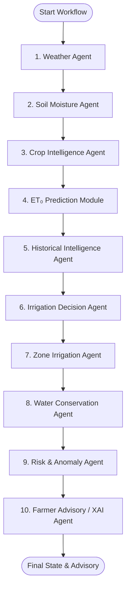

# Autonomous Farming Agents for Intelligent Irrigation Scheduling and Water Conservation

A completely software-based Agentic AI system for intelligent irrigation scheduling and water conservation.

---

## 🚀 Quick Access Dashboard Links

When running locally, access the interactive interfaces and APIs via these links:

| Interface | Direct URL | Description |
|---|---|---|
| **🧪 Interactive Decision Console** | **[http://localhost:3000/irrigation/decision](http://localhost:3000/irrigation/decision)** | **Primary experimentation interface**: Tune soil, weather, crop phenology, and water parameters, and execute the 10-agent LangGraph pipeline in real time. |
| **📊 Farm Overview Dashboard** | **[http://localhost:3000](http://localhost:3000)** | Multi-zone farm monitoring, live weather gauges, and daily virtual simulation stepper. |
| **📖 Backend Swagger API Docs** | **[http://127.0.0.1:8080/docs](http://127.0.0.1:8080/docs)** | Interactive OpenAPI / Swagger UI to test and execute all backend REST endpoints. |
| **💓 System Health Check** | **[http://127.0.0.1:8080/api/v1/health](http://127.0.0.1:8080/api/v1/health)** | Live FastAPI system and database connectivity health probe. |

---

## Project Overview

Agriculture accounts for approximately 70% of global freshwater withdrawals, with conventional calendar-based irrigation often leading to significant over-irrigation, deep drainage runoff, and nutrient leaching. Conversely, under-irrigation induces acute crop moisture stress, impairing yield.

This system replaces static scheduling with a multi-agent AI architecture grounded in **FAO-56 Penman-Monteith physics equations**, dynamic root-zone soil water balance modeling, machine learning evapotranspiration ($ET_0$) forecasting, and explainable AI (XAI).

> **Architectural Guarantee**: All numerical values ($ET_0$, $ET_c$, application depths in mm, volumes in Liters, soil stress indices, crop coefficients $K_c$) originate strictly from validated mathematical equations and machine learning models — **never from LLM hallucinations**.

---

## Multi-Agent Architecture

The system operates as a coordinated multi-agent workflow orchestrated using **LangGraph**:



### Specialized Agents

1. **Weather Intelligence Agent (`WeatherAgent`)**:
   - Ingests agro-meteorology from NASA POWER and OpenWeatherMap APIs.
   - Computes rainfall probability, wind velocity, and evaluates irrigation suitability rules.
2. **Soil Moisture Agent (`SoilAgent`)**:
   - Models zone soil profiles ($\theta$, $\theta_{FC}$, $\theta_{WP}$).
   - Computes Total Available Water ($TAW$), Readily Available Water ($RAW$), and root-zone depletion ($D_r$).
3. **Crop Intelligence Agent (`CropAgent`)**:
   - Ingests crop phenology across FAO-56 growth stages (`initial`, `development`, `mid`, `late`).
   - Dynamically interpolates $K_c$ coefficients and root depth ($Z_r$) to compute crop water requirement ($ET_c$).
4. **$ET_0$ Prediction Module (`ET0PredictionModule`)**:
   - Computes 13-step FAO-56 Penman-Monteith reference evapotranspiration ($ET_0$).
   - Features a Scikit-Learn `GradientBoostingRegressor` ML model pipeline achieving $R^2 > 0.98$.
5. **Historical Intelligence Agent (`HistoricalAgent`)**:
   - Audits 30-day cumulative rainfall and 7-day irrigation usage.
   - Detects historical over/under-irrigation trends and volumetric consumption in Liters.
6. **Irrigation Decision Agent (`IrrigationDecisionAgent`)**:
   - Multi-criteria agricultural rules engine evaluating weather, depletion, and stress.
   - Produces priority-ranked directives (`REQUIRED`, `POSTPONED`, `NOT_REQUIRED`).
7. **Zone Irrigation Agent (`ZoneIrrigationAgent`)**:
   - Multi-zone precision scheduler handling heterogeneous soils, crops, and emitter hydraulic limits.
8. **Water Conservation & Optimization Agent (`WaterOptimizationAgent`)**:
   - Computes water savings in mm, percentage reduction, and Liters saved vs conventional 25.0 mm schedules.
   - Audits over-irrigation prevention (averted deep drainage) and under-irrigation safeguards.
9. **Risk & Anomaly Agent (`RiskAnomalyAgent`)**:
   - Evaluates hazards: frost ($\le 2^\circ\text{C}$), heatwaves ($\ge 38^\circ\text{C}$), rain conflict ($\ge 5\text{ mm}$), high wind ($\ge 8\text{ m/s}$), waterlogging, severe drought, and sensor anomalies.
10. **Farmer Advisory Agent (`FarmerAdvisoryAgent`)**:
    - Synthesizes transparent, explainable natural language advisories attributing every recommendation to exact sensor and agro-climatic facts.

---

## Tech Stack

- **Backend**: Python 3.12, FastAPI, SQLAlchemy 2.0, PostgreSQL 17, Alembic
- **Orchestration**: LangGraph, LangChain, Pydantic v2
- **Machine Learning**: Scikit-Learn (Gradient Boosting Regressor), Pandas, NumPy
- **Frontend**: React 19, TypeScript, Vite, Tailwind CSS v4, Lucide Icons, Recharts
- **Simulation**: Virtual IoT environmental and soil moisture dynamic simulator

---

## Getting Started

### 1. Prerequisites
- Python 3.12+
- Node.js 20+ & npm
- PostgreSQL 17 (port 5432)

### 2. Backend Setup
```powershell
cd backend
.\.venv\Scripts\Activate.ps1
# Install dependencies if not already installed
pip install -r requirements.txt

# Run migrations and seed database
alembic upgrade head
python -m app.database.seed

# Run backend tests
pytest -v

# Start FastAPI backend server
uvicorn app.main:app --reload --port 8080
```

### 3. Frontend Setup
```powershell
cd frontend
npm install
npm run build
npm run dev
```
Open **`http://localhost:3000/irrigation/decision`** to access the interactive experimentation console, or **`http://localhost:3000`** for the overview dashboard.

---

## API Documentation

When the backend server is running, interactive Swagger UI documentation is available at:
**`http://127.0.0.1:8080/docs`**

Key API Endpoints:
- `POST /api/v1/irrigation/decision`: Execute multi-agent irrigation decision with custom agricultural inputs
- `GET /api/v1/irrigation/history`: Query persistent execution and decision audit history
- `GET /api/v1/health`: System and database health status
- `GET /api/v1/farms`: List all active farms, fields, and zones
- `GET /api/v1/crops`: Seeded FAO-56 crop database
- `POST /api/v1/agents/run`: Trigger full multi-agent orchestration workflow
- `POST /api/v1/simulation/advance`: Advance virtual farm IoT telemetry and day cycle